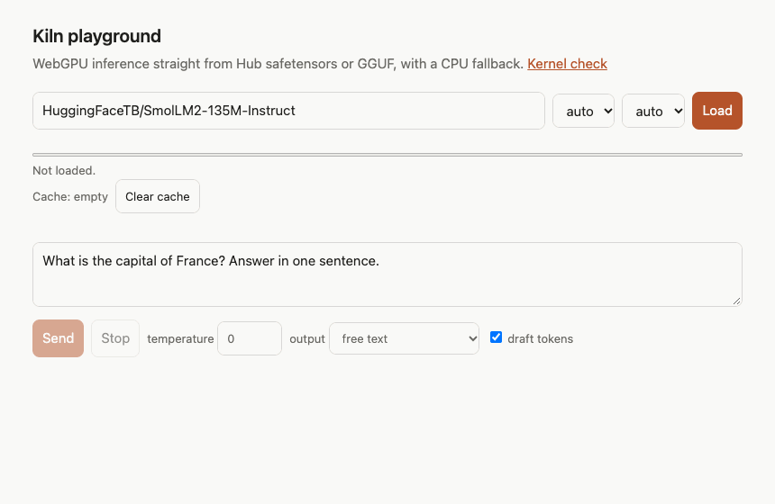
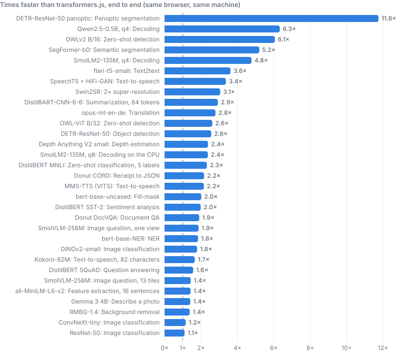

<h1 align="center">
  
  
</h1>

<p align="center"><strong>Run AI models in the browser on WebGPU, straight from their original weights.</strong></p>

<p align="center">
  <a href="https://www.npmjs.com/package/kiln-webgpu"></a>
  <a href="https://github.com/erdemozkan/kiln/actions/workflows/ci.yml"></a>
  
  
  
  
</p>

Kiln is a JavaScript library that runs language, vision and speech models entirely in the browser.
It reads a model's own files (safetensors, `pytorch_model.bin` or GGUF) from the Hugging Face Hub
or from your own server, so there is no ONNX export, no compile step and no inference server. It uses transformers.js's API names, so
most existing code moves over by changing the import and the model id.

<p align="center">
  
</p>

## Features

- **Original weights, no conversion.** Point at a model's repo on the Hugging Face Hub or a single `.gguf` file. Kiln quantizes to 4-bit or 8-bit while loading, so one repo serves every precision.
- **Not tied to the Hub.** Pass `endpoint` to load the same files from a mirror or your own static server, including models you trained yourself. A single `.gguf` also loads from any URL. Models on the user's own computer load too, from a picked `.gguf` file or a picked model folder, read in place with nothing uploaded. In Node.js, give the path of a folder or a `.gguf` file.
- **Gated and private models.** `setAccessToken(token)` adds a Hugging Face access token to requests for repo files. It is sent to `https://huggingface.co` only, never to a mirror, an `endpoint` or the URL of a single file.
- **A familiar API.** `pipeline`, `AutoTokenizer`, `AutoModel` and `TextStreamer` with transformers.js's option names and output shapes.
- **Many tasks.** Chat and text generation, embeddings, classification, NER, question answering, translation, summarization, speech recognition, text-to-speech, image classification, object detection, segmentation, Segment Anything (click or box an object to cut it out), depth, background removal, image or document questions, and pictures from text.
- **Structured output.** Constrain any LLM's reply to a JSON schema, a regex, a grammar or a list of choices.
- **More for LLMs.** [Tool calls and built-in skills](docs/tools.md), LoRA adapters, a retrieval helper, and prompt caching across calls and reloads.
- **Loads once.** Downloads are cached in the browser, resume if interrupted, and cached models load offline.
- **Stays out of the way.** Models run in a worker and stream text back; the page never blocks.
- **Small.** One 260 KB (gzipped) ES module that also works straight from a CDN, with a CPU fallback where there is no WebGPU.

## Principles

- **Original weights.** A model loads from the files its authors published. No conversion step sits between you and the model.
- **Correct before fast.** Every model is checked against transformers.js or Python on the same inputs. A speed-up that changes the output isn't one.
- **Modest hardware first.** The benchmarks are measured on a 2017 laptop with integrated graphics, because that is the kind of machine Kiln was built to put back to work.
- **Honest numbers.** The benchmarks list where Kiln is slower, not only where it wins.
- **Small footprint.** One 260 KB file with its worker inside, no runtime dependencies and no WASM runtime to download.
- **Nothing leaves the browser.** Models run on the user's own device. Prompts, images and audio are never sent to a server.

## Prerequisites

- **A browser with WebGPU** for full speed: current Chrome or Edge, Safari 26 or newer, or Firefox 141 or newer on Windows. Without WebGPU, Kiln runs on the CPU (WASM SIMD), more slowly.
- **Nothing to install** when importing from a CDN. With a bundler, any setup that handles ES modules works (Vite, webpack 5 and others).
- **Node 22.12 or newer** to run Kiln in Node.js, or to build this repository yourself. In Node.js Kiln runs on the CPU, or on the GPU once the `webgpu` package (Dawn's WebGPU for Node) is installed beside it (on a Mac, macOS 15 or newer).

## Quickstart

Install it:

```bash
npm install kiln-webgpu
```

Or import it with no install and no bundler:

```html
<script type="module">
  import { pipeline } from "https://cdn.jsdelivr.net/npm/kiln-webgpu@0.2.0";
</script>
```

This repository's site serves the library too: each release at its own address (`https://erdemozkan.github.io/kiln/0.2.0/kiln-webgpu.js`), and the latest build from `main` at `https://erdemozkan.github.io/kiln/kiln-webgpu.js`.

Chat with a model, using the transformers.js-style pipeline:

```js
import { pipeline } from "kiln-webgpu";

const generator = await pipeline("text-generation", "HuggingFaceTB/SmolLM2-135M-Instruct", {
  dtype: "q4",
  progress_callback: (p) => console.log(p.status, p.file ?? "", p.progress ?? ""),
});
const [out] = await generator([{ role: "user", content: "Hi!" }], { max_new_tokens: 128 });
console.log(out.generated_text.at(-1).content);
```

Or stream the reply with Kiln's own API:

```js
import { load } from "kiln-webgpu";

const llm = await load("HuggingFaceTB/SmolLM2-135M-Instruct", {
  onProgress: (p) => (bar.value = p.loaded / p.total), // drives a <progress> element
});
for await (const text of llm.chat([{ role: "user", content: "Hi!" }])) output.append(text);
```

Other tasks work the same way:

```js
const embed = await pipeline("feature-extraction", "sentence-transformers/all-MiniLM-L6-v2");
const vectors = await embed(["Hello world", "Hi"], { pooling: "mean", normalize: true });

const transcribe = await pipeline("automatic-speech-recognition", "openai/whisper-tiny.en");
const { text } = await transcribe("speech.wav");
```

In Node.js the same code runs on the CPU, and a path loads a model from disk:

```js
const embed = await pipeline("feature-extraction", "./models/all-MiniLM-L6-v2");
const chat = await pipeline("text-generation", "/data/SmolLM2-135M-Instruct-Q8_0.gguf");
```

For the GPU in Node.js, install Dawn's WebGPU bindings next to Kiln (`npm install kiln-webgpu webgpu`). Kiln finds the package by itself and runs the same kernels as in the browser; without it, it runs on the CPU as before.

From Python, the same pipelines run through the `kiln-webgpu` package in [python/](python/README.md), which drives Kiln in a Node.js process:

```python
from kiln_webgpu import pipeline

embed = pipeline("feature-extraction", "sentence-transformers/all-MiniLM-L6-v2")
vectors = embed(["Hello world", "Hi"], pooling="mean", normalize=True)
```

### Tools and skills

A chat model can call your functions, and Kiln ships four ready-made skills: a calculator, the date and time, a Wikipedia lookup and a web page reader. Calls are generated under a grammar, so their names and arguments always match your tools.

```js
import { load, runTools, skills } from "kiln-webgpu";

const llm = await load("ibm-granite/granite-4.0-1b-GGUF/granite-4.0-1b-Q8_0.gguf");
const { content } = await runTools(llm, [{ role: "user", content: "What time is it in Tokyo right now?" }], { tools: skills() });
```

The [tools and skills guide](docs/tools.md) covers writing your own tools, the options, privacy, Python, and [which model to pick](docs/skill-models.md). To try it, open the playground's [Skills page](https://erdemozkan.github.io/kiln/playground/tools.html), which has ready scenarios.

To try the playground from the animation above:

```bash
git clone https://github.com/erdemozkan/kiln.git && cd kiln && npm install && npm run dev
```

## Benchmarks

Kiln against transformers.js in the same browser on the same machine, on the same inputs. Across 31 task and model pairs, Kiln was faster end to end on every one, with a median speed-up of 2.2×.

<p align="center">
  
</p>

Measured on an Intel Mac with integrated graphics (Iris Plus 650) in Chrome; times are the median of three warm calls. On an Apple M3, Kiln decodes SmolLM2-135M at about 307 tokens per second.

Where Kiln is behind: download size for 4-bit models (transformers.js's ONNX repos ship pre-quantized files) and full masked-LM logits through `AutoModelForMaskedLM`. Loading an already cached model takes about the same time in both (1.6 s against 1.7 s for SmolLM2-135M). Outputs were checked against transformers.js or Python on every model; the [technical notes](docs/technical-notes.md) have each comparison.

## The story behind Kiln

The idea came when I heard Sam Altman saying “quite terrible to have everybody have a bunch of the world’s limited supply of DRAM sitting in their own computer… being used 5% of the time” in a [podcast](https://finance.yahoo.com/technology/ai/articles/quite-terrible-sam-altman-says-184500058.html). It made me think of my retired 2017 MacBook Pro, an i7 with 16 GB of RAM, doing nothing in a drawer.

I wanted to put it back to work, and I wanted that to be as easy as opening a web page: no installs, no servers, only a browser. I also wanted other developers like me to be able to use the idle memory and processing power of their own devices for small AI tasks just as easily.

So Kiln was born from one idea: don't kill the potential of the hardware we already own. I studied where transformers.js falls short and focused on making models run well on modest, everyday devices, anything that can open a browser with WebGPU.

## About

Kiln implements each model family itself, as WebGPU kernels, instead of running an exported ONNX graph. That is what lets it load original weights and GGUF files, and it is also why its list of supported architectures is shorter than transformers.js's.

- **Guide and API:** [package README](packages/kiln-webgpu/README.md)
- **Docs site, examples and migration guide:** in [`site/`](site); `npm run dev:site` serves it locally
- **Design, measurements and per-model notes:** [technical notes](docs/technical-notes.md)
- **Tools and skills:** [guide](docs/tools.md) and [model scores](docs/skill-models.md)
- **Changes:** [CHANGELOG](CHANGELOG.md)

## Contributing

Contributions are welcome. Kiln supports a model family only once someone has implemented it, so the most useful help is telling us which models you need: [open an issue](https://github.com/erdemozkan/kiln/issues) for a model, a bug or an idea.

To work on the code you need Node 22.12 or newer:

```bash
npm install
npm test
npm run typecheck
npm run dev
```

`npm run dev` serves the playground at `http://localhost:5173`. The [technical notes](docs/technical-notes.md) explain the design and how each model was checked, and the [future features plan](docs/future-features-plan.md) lists what is planned next. A change that affects a model's output should come with a comparison against a reference, the same way the existing models were checked.

## License

Kiln's code is [MIT licensed](LICENSE). It has no runtime dependencies.

Model weights are not bundled and keep their publishers' terms: check a model's card before shipping it. The default background-removal model, RMBG-1.4, is licensed for non-commercial use only.

<p align="center">Made in New York with 🧡 by Erdem Ozkan</p>
