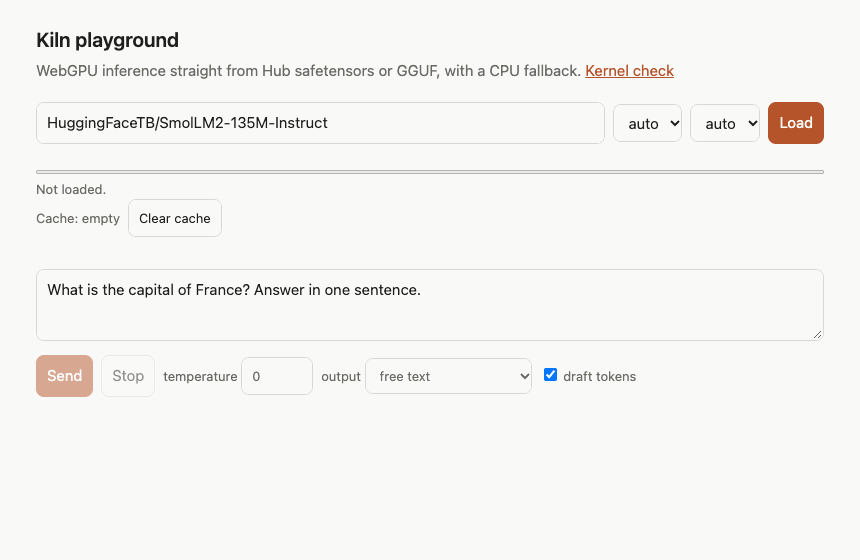
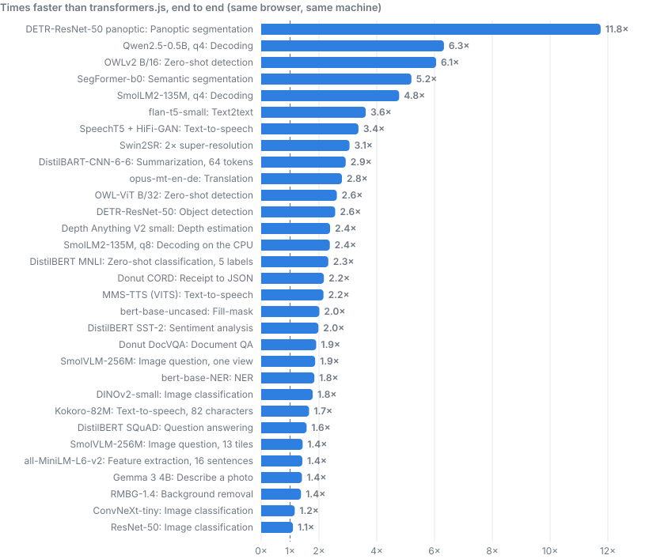

<h1 align="center">
  
  
</h1>

<p align="center"><strong>Run Hugging Face models in the browser on WebGPU, straight from their original weights.</strong></p>

<p align="center">
  
  
  
  
  
  
</p>

Kiln is a JavaScript library that runs language, vision and speech models entirely in the browser.
It reads a model's own files from the Hugging Face Hub (safetensors, `pytorch_model.bin` or GGUF),
so there is no ONNX export, no compile step and no server. It uses transformers.js's API names, so
most existing code moves over by changing the import and the model id.

<p align="center">
  
</p>

## Features

- **Original weights, no conversion.** Point at the model's own repo or a single `.gguf` file. Kiln quantizes to 4-bit or 8-bit while loading, so one repo serves every precision.
- **A familiar API.** `pipeline`, `AutoTokenizer`, `AutoModel` and `TextStreamer` with transformers.js's option names and output shapes.
- **Many tasks.** Chat and text generation, embeddings, classification, NER, question answering, translation, summarization, speech recognition, text-to-speech, image classification, object detection, segmentation, depth, background removal, and image or document questions.
- **Structured output.** Constrain any LLM's reply to a JSON schema, a regex, a grammar or a list of choices.
- **More for LLMs.** Tool calls, LoRA adapters, a retrieval helper, and prompt caching across calls and reloads.
- **Loads once.** Downloads are cached in the browser, resume if interrupted, and cached models load offline.
- **Stays out of the way.** Models run in a worker and stream text back; the page never blocks.
- **Small.** One 241 KB (gzipped) ES module that also works straight from a CDN, with a CPU fallback where there is no WebGPU.

## Prerequisites

- **A browser with WebGPU** for full speed: current Chrome or Edge, Safari 26 or newer, or Firefox 141 or newer on Windows. Without WebGPU, Kiln runs on the CPU (WASM SIMD), more slowly.
- **Nothing to install** when importing from a CDN. With a bundler, any setup that handles ES modules works (Vite, webpack 5 and others).
- **Node 22.12 or newer** only if you build this repository yourself.

## Quickstart

Install it:

```bash
npm install kiln-webgpu
```

Or import it with no install and no bundler:

```html
<script type="module">
  import { pipeline } from "https://cdn.jsdelivr.net/npm/kiln-webgpu@0.1.0";
</script>
```

Chat with a model, using the transformers.js-style pipeline:

```js
import { pipeline } from "kiln-webgpu";

const generator = await pipeline("text-generation", "HuggingFaceTB/SmolLM2-135M-Instruct", {
  dtype: "q4",
  progress_callback: (p) => console.log(p.status, p.file ?? "", p.progress ?? ""),
});
const [out] = await generator([{ role: "user", content: "Hi!" }], { max_new_tokens: 128 });
console.log(out.generated_text.at(-1).content);
```

Or stream the reply with Kiln's own API:

```js
import { load } from "kiln-webgpu";

const llm = await load("HuggingFaceTB/SmolLM2-135M-Instruct", {
  onProgress: (p) => (bar.value = p.loaded / p.total), // drives a <progress> element
});
for await (const text of llm.chat([{ role: "user", content: "Hi!" }])) output.append(text);
```

Other tasks work the same way:

```js
const embed = await pipeline("feature-extraction", "sentence-transformers/all-MiniLM-L6-v2");
const vectors = await embed(["Hello world", "Hi"], { pooling: "mean", normalize: true });

const transcribe = await pipeline("automatic-speech-recognition", "openai/whisper-tiny.en");
const { text } = await transcribe("speech.wav");
```

To try the playground from the animation above:

```bash
git clone https://github.com/erdemozkan/kiln.git && cd kiln && npm install && npm run dev
```

## Benchmarks

Kiln against transformers.js in the same browser on the same machine, on the same inputs. Across 31 task and model pairs, Kiln was faster end to end on every one, with a median speed-up of 2.2×.

<p align="center">
  
</p>

Measured on an Intel Mac with integrated graphics (Iris Plus 650) in Chrome; times are the median of three warm calls. On an Apple M3, Kiln decodes SmolLM2-135M at about 307 tokens per second.

Where Kiln is slower: loading a model that is already cached, download size for 4-bit models (transformers.js's ONNX repos ship pre-quantized files), and full masked-LM logits through `AutoModelForMaskedLM`. Outputs were checked against transformers.js or Python on every model; the [technical notes](docs/technical-notes.md) have each comparison.

## The story behind Kiln

The idea came when I heard Sam Altman saying “quite terrible to have everybody have a bunch of the world’s limited supply of DRAM sitting in their own computer… being used 5% of the time” in a [podcast](https://finance.yahoo.com/technology/ai/articles/quite-terrible-sam-altman-says-184500058.html). It made me think of my retired 2017 MacBook Pro, an i7 with 16 GB of RAM, doing nothing in a drawer.

I wanted to put it back to work, and I wanted that to be as easy as opening a web page: no installs, no servers, only a browser. I also wanted other developers like me to be able to use the idle memory and processing power of their own devices for small AI tasks just as easily.

So Kiln was born from one idea: don't kill the potential of the hardware we already own. I studied where transformers.js falls short and focused on making models run well on modest, everyday devices, anything that can open a browser with WebGPU.

## About

Kiln implements each model family itself, as WebGPU kernels, instead of running an exported ONNX graph. That is what lets it load original weights and GGUF files, and it is also why its list of supported architectures is shorter than transformers.js's.

- **Guide and API:** [package README](packages/kiln-webgpu/README.md)
- **Docs site, examples and migration guide:** in [`site/`](site); `npm run dev:site` serves it locally
- **Design, measurements and per-model notes:** [technical notes](docs/technical-notes.md)
- **Changes:** [CHANGELOG](CHANGELOG.md)

Kiln is released under the [MIT license](LICENSE). Models keep their own licenses: check a model's card before shipping it (the default background-removal model, RMBG-1.4, is non-commercial).

<p align="center">Made in New York with 🧡 by Erdem Ozkan</p>
